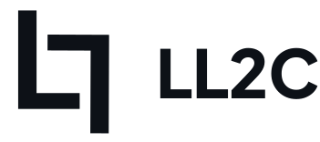
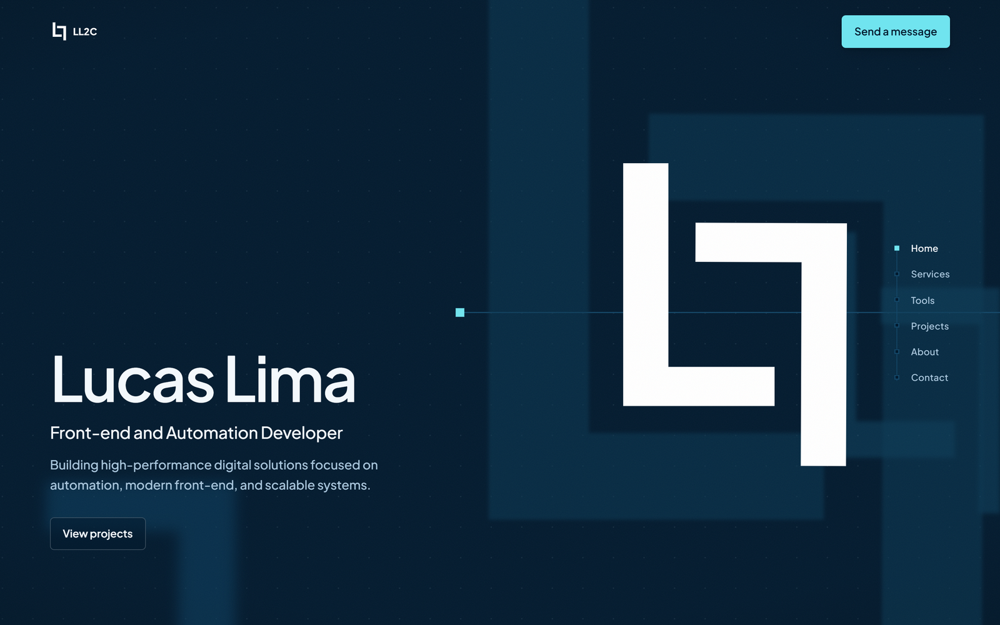

  <picture>
    <source media="(prefers-color-scheme: dark)" srcset="assets/Logo-complete.svg">
    
  </picture>

  

<h1 align="center">LL2C · Lucas Lima</h1>

Personal portfolio of Lucas Lima, front-end and automation developer.

  
  
  

## About

This is my portfolio. It shows what I do, the tools I use every day, and a few real projects.
The main page is a single scroll journey drawn from the LL2C brand: a circuit line you follow from start to finish.

**Live:** https://ll2c.vercel.app/

## What you'll find

- **Home**: who I am, inside the LL2C symbol.
- **Services**: AI automations, full stack development and freelance work.
- **Tools**: the six tools I use most. Each one passes along the line and the LL2C bracket closes around it.
- **Projects**: Rise App, ChatAI and Dashboard Controlnomy, with links.
- **About**: where I come from.
- **Contact**: a short form to send me a message.

The previous version of the portfolio is still available at `/personal`.

## Built with

- React and TypeScript
- Vite
- Tailwind CSS

## Author

**LL2C**: [@LucasLima0202](https://github.com/LucasLima0202)

<!-- TODO: add a LICENSE file -->
